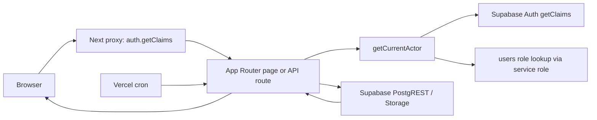

# System Design Audit

**Scope:** repository-only, read-only audit performed 16 October 2026. This document describes observed implementation, not a production performance measurement. Secrets, personal data, and environment-variable values are omitted.

## 1. Stack and deployment

| Area | Observed implementation | Evidence |
|---|---|---|
| Framework | Next.js `16.3.4`, React `19.2.8`, TypeScript `5.7.2`; App Router (`app/` pages and route handlers). | `package.json:18-23`; `app/` tree |
| Data/access SDKs | `@supabase/supabase-js` `2.116.0` and `@supabase/ssr` `0.12.7`. No ORM is installed; application queries use the Supabase PostgREST client. | `package.json:18-23`; `lib/supabase/admin.ts:2,12`; `lib/supabase/server.ts:1,7` |
| Hosting config in repo | `vercel.json` defines four cron invocations. It contains no region, runtime, max-duration, or Vercel project setting. | `vercel.json:1-20` |
| Server connection | Server Components and most route handlers use an authenticated cookie-backed server client; privileged application work uses a service-role client. Both connect through Supabase JS, not a direct Postgres driver or connection-string pooler. | `lib/supabase/server.ts:4-26`; `lib/supabase/admin.ts:4-14` |
| Browser connection | The login form uses `createBrowserClient`; observed data mutations use API routes rather than browser-side table queries. | `lib/supabase/client.ts:3-8`; `app/login/login-form.tsx:16` |
| Required environment variable names | `NEXT_PUBLIC_SUPABASE_URL`, `NEXT_PUBLIC_SUPABASE_PUBLISHABLE_KEY`, `SUPABASE_SERVICE_ROLE_KEY`, and `CRON_SECRET`. Values are redacted. | `.env.example:1-4`; `lib/supabase/admin.ts:5-9` |
| Request middleware/proxy | The global `proxy` matcher excludes static assets but otherwise calls `updateSession`, which constructs a Supabase server client and calls `auth.getClaims()` on each matched request. | `proxy.ts:4-10`; `lib/supabase/proxy.ts:4-28` |
| Third parties | Supabase Auth, PostgREST, and Storage are the only externally addressed services in the code. No Interakt or email-provider HTTP calls were found. | `rg` inventory of `app/`, `lib/`, `scripts/` |

**Unknowns:** Vercel region, function runtime/timeout settings, plan, deployed Node version, Supabase region, Supabase compute tier, and whether Vercel/Supabase are co-located. These require the Vercel project settings and Supabase project settings dashboards. No PostgreSQL pooler/port configuration is visible in this repository.

## 2. Route and rendering inventory

All page routes are dynamic server-rendered on demand in the audited build; the build output labels them `ƒ`. No page defines `revalidate`, `dynamic`, `loading.tsx`, or Suspense boundaries in the repository. Exact per-route JavaScript bundle sizes are not printed by the Next 16 build output captured for this audit.

| Page route | Access | First-load data work after proxy/auth | Query ordering / notes |
|---|---|---|---|
| `/` | authenticated redirect target | Redirects to `/dashboard`. | `app/page.tsx:4` |
| `/login` | public | No database page query; browser sign-in calls Supabase Auth. | `app/login/page.tsx`; `app/login/login-form.tsx:16-30` |
| `/dashboard` | authenticated | Actor lookup, a second auth claim lookup, deadline refresh writes, tasks, users, notifications, and signed URLs per proof. | Actor/auth calls are sequential; task/users/notifications are parallel after deadline refresh. `app/dashboard/page.tsx:13-49` |
| `/templates` | admin/manager | Actor lookup, templates and users. | The two data selects are parallel. `app/templates/page.tsx:10-16` |
| `/calendar` | authenticated | Actor lookup, upcoming requests, holidays, users. | Three selects are parallel and each calendar list is limited to 30. `app/calendar/page.tsx:10-17` |
| `/activity` | admin/manager | Actor, latest 50 audit rows, then users and selected task titles. | Audit fetch precedes two parallel enrichment queries. `app/activity/page.tsx:33-50` |
| `/reports` | admin/manager | Actor, seven-day tasks and all visible users. | Two selects run in parallel; totals are calculated in JavaScript. `app/reports/page.tsx:24-51` |
| `/architect-export` | authenticated | Actor and state-list RPC. | One RPC after actor lookup. `app/architect-export/page.tsx:3` |
| `/architect-import` | authenticated | Actor only. | Import executes after client submission. `app/architect-import/page.tsx:7` |
| `/campaigns` | authenticated | Actor, scoped users for non-admins, then matching campaigns. | All matching campaigns are fetched and client-filtered. `app/campaigns/page.tsx:3`; `app/campaigns/campaign-list.tsx:9-31` |
| `/campaigns/new` | authenticated | Actor only. | Form submits later to API. `app/campaigns/new/page.tsx:5` |
| `/campaigns/[id]` | authenticated/in scope | Actor, campaign, then role/assignment-related data. | Route uses service-role client. `app/campaigns/[id]/page.tsx:11+` |
| `/lead-sheets/[taskId]` | owner/manager/admin | Actor, task, possible manager lookup, then weekly sheet or backlog. | Mostly sequential. `app/lead-sheets/[taskId]/page.tsx:4-6` |
| `/leads` | authenticated | Actor only. | Contact and lead lookup occur client-side after input. `app/leads/page.tsx:2`; `app/leads/lead-entry-form.tsx:8-10` |
| `/contact-preferences` | authenticated | Actor only. | Contact lookup/suppression occurs client-side after input. `app/contact-preferences/page.tsx:7` |
| `/export-audit` | admin/manager | Actor, scoped users, unbounded matching export logs joined to users. | `app/export-audit/page.tsx:3` |
| `/users` | admin | Actor and user-management data. | `app/users/page.tsx:9-10` |

The application also has API route handlers under `/api/*` for task, campaign, import/export, lead, calendar, notification, and cron operations. Build evidence: `npm run build` on 16 October 2026 listed 38 dynamic application routes.

## 3. What happens on user actions

| Action | Path from UI to database/UI | Observed refresh behavior |
|---|---|---|
| Sidebar navigation | Next `Link` navigation goes through the proxy (`auth.getClaims`), then each destination page calls `getCurrentActor`; that function performs auth claims and a service-role users lookup. | No explicit prefetch configuration observed. `proxy.ts:4-10`; `lib/auth/current-actor.ts:11-35` |
| Generate today | Client POSTs `/api/admin/generate-tasks`; API authenticates/authorizes, reads users, invokes task generation, and writes created tasks; client calls `router.refresh()`. | Full current route refresh. `app/dashboard/task-list.tsx:51-59`; `app/api/admin/generate-tasks/route.ts:24-38` |
| Add task / update task / upload proof | Client calls `/api/tasks`, `/api/tasks/[id]`, or proofs route. Each route authenticates; task update reads then updates the task. Proof upload uses multipart request and Storage. | `router.refresh()` after each. `app/dashboard/manual-task-form.tsx:20-30`; `app/dashboard/task-list.tsx:81-110`; `app/api/tasks/[id]/route.ts:9-60` |
| Templates | Client API POST/PATCH/DELETE. Route uses current actor and cookie-backed Supabase client. | `router.refresh()` after each. `app/templates/template-form.tsx:25-43`; `app/templates/template-list.tsx:40-65` |
| Campaign list/detail/metrics/assignment/create/delete | List is server data. Detail actions use API routes; metrics route first fetches campaign ownership then updates. Assignment validates employee then updates. Create inserts. Single delete redirects then refreshes; bulk delete reloads whole page. | Detail metrics/assignment show a message but do not refresh; deletes do. `app/campaigns/[id]/campaign-metrics-form.tsx:5`; `app/api/campaigns/[id]/route.ts:11-33`; `app/campaigns/campaign-list.tsx:20-25` |
| Lead lookup and mark | Client sends two parallel lookups: architect/birthday contacts and existing lead. Mark route optionally fetches architect, fetches lead by phone, then inserts or updates lead and inserts interaction. | Local form state is cleared; no route refresh. `app/leads/lead-entry-form.tsx:8-10`; `app/api/leads/route.ts:17-38` |
| Do-not-contact | Client lookup calls architect lookup, then client POSTs suppression route. Route upserts suppression with service role. | Local message only. `app/contact-preferences/preferences-form.tsx:6-7`; `app/api/contact-suppressions/route.ts:13-24` |
| Users / calendar | Client API calls authenticate and execute the related write(s). | `router.refresh()` following save/delete/approval. `app/users/user-management-client.tsx:17-32`; `app/calendar/calendar-client.tsx:26-121` |
| Reports / activity | Server-rendered reads described in section 2. | No client refetching or pagination. |

## 4. Data layer

### Tables and observed query keys

| Table(s) | Purpose | Observed filtering/sorting/join keys | Row count / growth status |
|---|---|---|---|
| `users`, `holidays`, `off_day_requests` | Team identity and calendar exceptions. | `users.id`, `manager_id`, role; holiday/request date. | Unknown; team-sized. Schema/indexes: `20250908180000_initial_schema.sql:50-101`. |
| `task_templates`, `tasks`, `task_proofs`, `task_blockers` | Recurring/manual tasks, proof, blocker workflow. | tasks `assigned_to, scheduled_date`, status, template; child `task_id`. | Unknown; tasks/audit grow over time. `20250908180000_initial_schema.sql:106-196`. |
| `audit_log`, `notifications` | Activity history and notification feed. | audit entity/actor/descending created time; notifications user/read and descending created time. | Unknown; append-heavy. `20250908180000_initial_schema.sql:202-236`. |
| `architects`, `birthday_contacts`, `contact_suppressions` | Exportable contact data and suppression list. | architects state+serial / phone / birthday; birthday month/day expression index; suppression phone. | Unknown; architects is the primary high-volume table. `20261014120000_birthday_contacts_shared_campaigns.sql:2-17`; `20261015223000_contact_suppressions.sql:1-13`. |
| `architect_export_logs`, `architect_export_items` | Export audit plus exported architect IDs. | log type/date; items export/architect. | 30-day retention job deletes old logs, but dependent item retention is only implied by FK cascade and must be verified. `lib/server/architect-exports.ts:70-76`; `app/api/cron/prune-export-audit/route.ts:7`. |
| `campaigns`, weekly lead sheet/backlog tables | Campaigns, scheduled follow-up work, checklist/backlog links. | created/assigned date, stage/date, campaign ID joins. | Unknown; campaigns can grow without a visible list limit. `20260913100000_architects_campaigns_and_leads.sql:91-140`; `20261014120000_birthday_contacts_shared_campaigns.sql:23-28`. |
| `leads`, `lead_interactions` | One lead per phone with a history of markings. | lead phone, engagement tag+last marked; interaction lead+time. | Unknown; append-heavy interactions. `20261015193000_shared_lead_contacts_and_email_campaigns.sql:5-39`. |

No database connection was used in this audit, so live row counts, `pg_class` estimates, and `EXPLAIN (ANALYZE, BUFFERS)` are **unknown**. The 15 representative high-frequency/heavy application query shapes are below; index coverage is assessed only from migrations, not query plans.

| Query shape | Evidence | Index coverage visible in migrations |
|---|---|---|
| Dashboard tasks by date/pool/status with deadline ordering | `app/dashboard/page.tsx:34-38` | `(assigned_to, scheduled_date)` exists, but dashboard query shown has no `assigned_to` filter; no observed combined scheduled/status/deadline index. |
| Dashboard notifications by user ordered by created time | `app/dashboard/page.tsx:42-43` | `(user_id, is_read)` and `created_at DESC` are separate; no observed `(user_id, created_at DESC)` index. |
| Deadline refresh task scan | `lib/server/refresh-deadline-alerts.ts:19+` | Needs plan verification; status/date indexes exist separately. |
| Daily generation current tasks/pool tasks | `lib/server/generate-daily-tasks.ts:21-25` | Uses separate date/status and assignee conditions; composite coverage uncertain. |
| Campaign listing by assigned users/shared and campaign date | `app/campaigns/page.tsx:3` | `(assigned_to, campaign_date)` exists; the `OR is_shared` branch may limit index use. |
| Campaign detail by ID | `app/campaigns/[id]/page.tsx:11+` | Primary key covers ID. |
| Export state scan/paging by state and serial | `lib/server/architect-exports.ts:37-43` | No observed `(state, serial_no)` index in migrations; requires plan verification. |
| Export suppressions full phone read | `lib/server/architect-exports.ts:46-49,62-65` | Phone index exists, but this query selects all suppression rows with no filter. |
| Birthday exports by `birthdate` | `lib/server/architect-exports.ts:54-57` | `birthday_contacts` has month/day expression index; code uses equality on `birthdate`, not the expression. Architect birthdate index was not observed. |
| Recent duplicate export log scan | `lib/server/architect-exports.ts:70-76` | No observed `(campaign_type, exported_at)` index; items has `(architect_id, export_id)`, not export-first. |
| Architect import state/serial validation | `app/api/architect-imports/route.ts:30-37` | No observed `(state, serial_no)` index. |
| Architect import names/phones validation | `app/api/architect-imports/route.ts:33-37` | Partial phone index exists. |
| Lead lookup/update by phone | `app/api/leads/lookup/route.ts:10`; `app/api/leads/route.ts:22` | Unique `leads(phone)` index exists. |
| Activity newest 50 and enrichment | `app/activity/page.tsx:39-50` | `audit_log(created_at DESC)` exists; enrichments use primary key `IN`. |
| Seven-day report task range | `app/reports/page.tsx:32-35` | `tasks(scheduled_date)` exists, but all matching rows are transferred for JS aggregation. |

### RLS, functions, triggers

RLS is enabled for the initial task tables and later architect/campaign/lead tables. RLS helpers are `SECURITY DEFINER` stable SQL functions. `can_access_user` can inspect `users`, and `can_access_task` reads `tasks`; policies call these helpers per access decision. This may be material at scale but needs query plans to quantify. Evidence: `20250908180001_rls_and_helpers.sql:6-82,87-214`; campaign shared policies: `20261014120000_birthday_contacts_shared_campaigns.sql:37-59`.

Observed triggers/functions include task timestamp/audit/notification behavior in the initial trigger migration and campaign total calculation on every relevant campaign insert/update. The campaign trigger writes only fields on `NEW`; deadline refresh itself may write task and notification rows. Evidence: `20261014120000_birthday_contacts_shared_campaigns.sql:61-78`; `lib/server/refresh-deadline-alerts.ts:45-56`.

## 5. Lists, pagination and volume

| UI/list | Limit/pagination | Filtering location | Volume risk |
|---|---|---|---|
| Dashboard tasks | No explicit limit; date/pool predicate server-side. | Server/PostgREST. | Daily sized, but proof signed URLs are generated per returned proof. |
| Campaigns | No limit/pagination. | Data loaded server-side; state/account/status/date filters are client-side. | Increases with campaign history. `app/campaigns/page.tsx:3`; `campaign-list.tsx:9-31`. |
| Activity | 50 rows. | Server query, then JS maps. | Bounded. `app/activity/page.tsx:39-50`. |
| Reports | No limit on seven-day task range. | Server query then JS aggregation. | Grows with task density/team size. |
| Export audit | No limit/pagination. | Server query. | Logical 30-day cap only. `app/export-audit/page.tsx:3`; cron `app/api/cron/prune-export-audit/route.ts:7`. |
| Templates/users | No observed explicit limit. | Server. | Low team/configuration volume. |
| Calendar requests/holidays | 30 each. | Server. | Bounded. `app/calendar/page.tsx:15-16`. |
| Architect export | State export pages through all state contacts in 1,000-row chunks before filtering; birthday export fetches every matching row. | Server memory/JS. | High-volume architect table. `lib/server/architect-exports.ts:36-50,54-65`. |
| Leads | No full lead list page observed. Lookups are exact-phone. | API/PostgREST. | Exact lookup is bounded; interactions grow indefinitely. |

## 6. Export and import

### CSV exports

State-wise export reads every architect in the requested state in repeated 1,000-row pages, applies state-relative serial selection, loads all suppressions, filters in memory, then holds selected data and final CSV string in function memory. It additionally performs duplicate-export checks, writes an audit log, creates a campaign, updates the audit row, and inserts architect export items. The entire CSV is returned in JSON and downloaded by client code, not streamed or stored. Evidence: `lib/server/architect-exports.ts:27-109`; `app/api/architect-exports/route.ts:5-17`; `app/architect-export/export-client.tsx:30+`.

Birthday export reads matching architects and birthday contacts in parallel, merges/deduplicates in memory, loads all suppressions, and follows the same response/audit/campaign flow. CSV rendering adds Country Code `91` and export-time name formatting. Evidence: `lib/server/architect-exports.ts:13-14,51-81`.

No max duration/runtime setting is in `vercel.json`; applicable deployed limits are unknown. No measured export time was recorded because no safe production database connection or realistic local database was available.

### Architect import

The import endpoint accepts a CSV up to 10 MB, uploads it to the private `architect-imports` bucket, downloads it immediately, parses/validates in memory, reads existing state/serial rows and candidate phones, then inserts all prepared rows in one call. It does not show a transaction around Storage upload, validation, and insert; the raw upload remains even if validation/insert fails. Evidence: `app/api/architect-imports/route.ts:6-43`; bucket: `20260927110000_architect_import_storage.sql:1-4`.

CLI import scripts use the service role and similar validation/query patterns; prepared campaign imports batch inserts by 100. Evidence: `scripts/import-architects.mjs:22-31`; `scripts/import-prepared-campaigns.mjs:34-44`.

## 7. Caching (what exists today)

No `revalidate`, route `dynamic` overrides, `unstable_cache`, `cache()`, explicit `fetch` cache mode, Cache-Control header, SWR, or React Query use was found. Consequently, dynamic page data is reloaded on navigation and `router.refresh()` refetches the current server route after many writes. Evidence: repository search for those constructs; refresh calls listed in section 3.

The app uses local React state for forms and messages only. It has a Supabase Storage private import bucket and creates one-hour signed proof URLs in dashboard rendering. Evidence: `app/dashboard/page.tsx:46-49`; `20260927110000_architect_import_storage.sql:1-4`.

Frequently read, rarely changing data includes users, roles, states, templates, holidays, accounts, and categories. State is fetched through `list_architect_states`; users/templates/holidays are otherwise fetched per applicable route. Evidence: `app/architect-export/page.tsx:3`; `app/templates/page.tsx:13-16`; `app/calendar/page.tsx:13-17`.

## 8. Client-side weight and UX

There are 19 files with a `"use client"` directive, covering navigation, forms, campaign interaction, task interaction, notifications, and theme switching. Evidence: file inventory under `app/`.

Installed browser-facing dependencies are Next/React, Supabase SSR client, and Lucide icons; no bundle analyzer output or route-size report is present. `app/architect-export/export-client.tsx` adds user-visible progress steps but they are timer/UI-state based, not server-reported progress. No realtime subscriptions or polling were found; notification updates are an explicit PATCH followed by `router.refresh()`. Evidence: `package.json:18-23`; `app/dashboard/notification-feed.tsx:22-24`.

No `loading.tsx` or `error.tsx` files were found. Many submit buttons have local busy/disabled state, but not every client action was exhaustively verified for double-submit handling.

## 9. Writes and concurrency

No explicit database transaction/RPC wraps multi-step workflows such as export audit + campaign + export items, lead update + interaction insert, or import storage + insert. Export partially compensates for campaign insertion failure by deleting the audit row, but later audit-update/item failures can leave partial state. Evidence: `lib/server/architect-exports.ts:94-108`; `app/api/leads/route.ts:25-37`; `app/api/architect-imports/route.ts:19-43`.

Task generation avoids same-day duplicates by reading existing rows before insert, but concurrency protection must be confirmed from schema constraints/production behavior. Cron jobs run daily generation, two deadline refreshes, and audit pruning at the schedules in `vercel.json:2-18`; cron routes validate a secret before doing service-role work. Evidence: `lib/server/generate-daily-tasks.ts:18-40`; `app/api/cron/*/route.ts`.

## 10. Observability

No error-tracking SDK, analytics SDK, tracing provider, structured request timing, or performance monitoring configuration was found in `package.json`, `app/`, or `lib/`. The application records business audit rows and export logs, which are not request-performance telemetry. Evidence: `package.json`; `app/activity/page.tsx:38-56`; `lib/server/architect-exports.ts:91-108`.

## 11. Measured baseline

No safe production measurements were run. No local database fixture or running local Supabase stack is configured in the repository, so server/DB timings and payload sizes are unknown. The Next production build completed locally on 16 October 2026, but build time is not a request-latency baseline.

| Action | Server time | DB time (sum) | Number of queries | Payload size | Notes |
|---|---:|---:|---:|---:|---|
| Login | Unknown | Unknown | 1 browser Auth request observed | Unknown | Requires deployed/local auth measurement. |
| Today load | Unknown | Unknown | At least auth/proxy + actor + deadline queries/writes + task/users/notifications; proof URL calls per proof | Unknown | See `app/dashboard/page.tsx:13-49`. |
| Campaigns list | Unknown | Unknown | At least actor + scoped-user query (non-admin) + campaigns query | Unknown | Unbounded list. |
| Campaign detail / Save metrics / Assign | Unknown | Unknown | Unknown / at least actor + campaign ownership + update / at least actor + user validate + update | Unknown | See section 3. |
| Lead lookup / Mark lead | Unknown | Unknown | Client lookup is two API calls; marking is 2-4 DB calls | Unknown | See `lead-entry-form.tsx:8-10`, `api/leads/route.ts`. |
| Reports | Unknown | Unknown | At least actor + 2 parallel selects | Unknown | Full seven-day task set transferred. |
| State/birthday CSV export | Unknown | Unknown | Multiple; state grows with 1,000-row pages | CSV string response | Whole-result memory/JSON response. |
| Architect import | Unknown | Unknown | Storage upload+download, 2 validation selects, insert | Up to 10 MB input | No timing available. |

## 12. Top suspected bottlenecks

| Rank | Suspected cause | Evidence and affected actions | Effort |
|---:|---|---|---|
| 1 | State export scans and retains every row in a state before selecting the requested valid contacts. | Pagination loop plus in-memory filter/slice: `lib/server/architect-exports.ts:36-50`. Affects state exports. | Medium |
| 2 | Export is executed twice in normal success flow: initial `selectArchitects`, then `createExport` calls it again. | `app/api/architect-exports/route.ts:10-14`; `lib/server/architect-exports.ts:84-85`. Affects all exports. | Small/medium |
| 3 | Every matched route performs proxy auth claims, then pages/routes frequently perform `getCurrentActor`, which calls auth claims again plus a user lookup. | `lib/supabase/proxy.ts:7-28`; `lib/auth/current-actor.ts:11-29`. Affects navigation and actions. | Medium |
| 4 | Dashboard executes deadline-refresh work, including reads and possible writes, during ordinary page rendering. | `app/dashboard/page.tsx:28`; `lib/server/refresh-deadline-alerts.ts:19-56`. Affects Today load. | Medium |
| 5 | Campaign, audit, and report lists are unpaginated; campaign filters run after entire list transfer. | `app/campaigns/page.tsx:3`; `app/campaigns/campaign-list.tsx:9-31`; `app/export-audit/page.tsx:3`; `app/reports/page.tsx:32-51`. | Medium |
| 6 | Whole suppression table is fetched for every export. | `lib/server/architect-exports.ts:46-49,62-65`. Affects both export types. | Small/medium |
| 7 | Several likely query shapes lack composite indexes visible in migrations, notably state+serial export and campaign type+export date duplicate checks. | Query/index comparison in section 4. Must confirm with `EXPLAIN`. | Small |
| 8 | Export CSV and its contact data are assembled in memory and returned as one JSON response instead of a streamed/download response. | `lib/server/architect-exports.ts:13-14,81`; `app/api/architect-exports/route.ts:14`. | Medium |
| 9 | Multi-step writes are not transactional, which can cause retries/partial-state cleanup work under errors. | `lib/server/architect-exports.ts:94-108`; `app/api/leads/route.ts:25-37`. | Medium/large |
| 10 | No cache is configured for repeatedly read reference data and no observability measures actual slow paths. | Section 7 and 10 evidence. | Medium |

These are code-structure hypotheses, not measured production rankings. Vercel/Supabase region mismatch remains possible but unproven from this repository.

## 13. Unknowns and questions for the owner

1. **Vercel placement and limits:** In Vercel project settings, provide region, runtime, max duration, plan, and function logs/timings for the slow endpoints.
2. **Supabase placement and capacity:** In Supabase settings, provide project region, compute size/plan, database connection metrics, and slow-query dashboard data.
3. **Live table sizes/index health:** Run row counts and `EXPLAIN (ANALYZE, BUFFERS)` for the query shapes in section 4 using a read-only database connection.
4. **Latency definition:** Provide representative observed durations (p50/p95) for login, Today, campaigns, save actions, and each export, plus concurrent-user count.
5. **Data growth:** Provide current and expected monthly row counts for architects, campaigns, tasks, export audit/items, leads, interactions, notifications, and audit log.
6. **Deployment parity:** Confirm that the deployed Vercel commit includes the audited source and the four listed environment variable names.
7. **Postgres functions/triggers/policies after migration:** Confirm the actual live schema (for example via Supabase schema inspector) matches all local migrations and has no dashboard-created objects not tracked in git.
